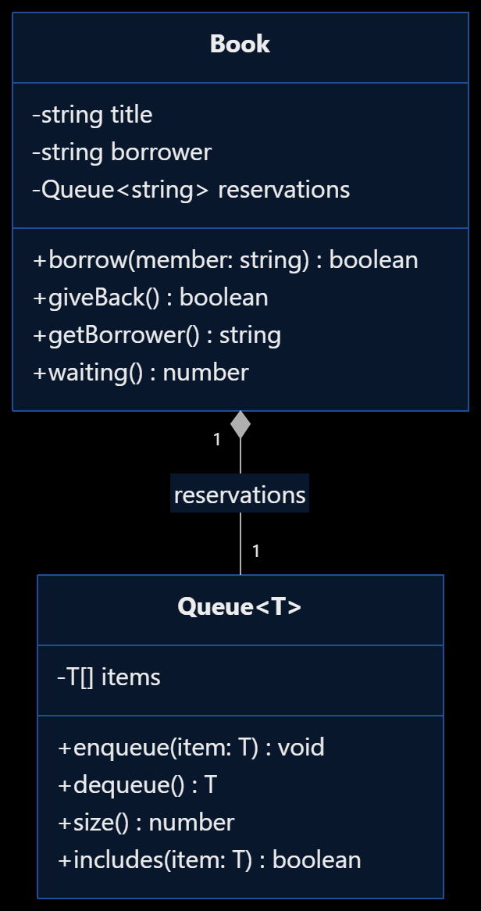

```text
Prediction 1.

Is any line underlined in red? What happens when you run the file?

Answer:

There are no red underlines because AnyList uses any, which disables TypeScript's type checking for those values.

When the program runs, awa.getName() works and prints Awa. However, awa.describe() causes a runtime TypeError because a Member object does not have a describe() method.

Question 1. What did any give up? Would memberList.add(42) be caught?

Answer:

The any type gives up TypeScript's type safety because it allows values of any type without checking whether they have the required properties or methods.

No, memberList.add(42) would not be caught because the add() method accepts any.
Part 2 — A Generic Catalog
Question 2. Why does TypeScript refuse to call getId() on a T?

Answer:

TypeScript does not know what type T represents, so it cannot guarantee that T has a getId() method.

The error is essentially:
Property 'getId' does not exist on type 'T'.


We solve this by defining the HasId interface and adding the constraint T extends HasId.

This guarantees that every type used in the catalog has a getId() method.

Question 3. Neither Book nor Member says implements HasId. Why are they accepted?

Answer:

TypeScript uses structural typing, meaning it checks whether an object has the required structure rather than whether it explicitly declares that it implements an interface.

Both Book and Member have a getId() method returning a string, so they satisfy the HasId interface.

Question 4. Explain experiments (a), (b) and (c).

(a)
books.add(new Member("M-02", "Moussa"));


TypeScript prevents adding a Member to a Catalog<Book> because the catalog only accepts objects of type Book.

(b)
const numbers = new Catalog<number>();


TypeScript prevents this because number does not satisfy the HasId constraint; numbers do not have a getId() method.

(c)
console.log(found.describe());


TypeScript prevents this because found could be undefined if the requested book does not exist.

We must first check that found exists:
if (found) {
  console.log(found.describe());
}


Question 5. Why did no test line change when switching from an array to a Map?

Answer:

The internal implementation changed, but the public interface of the Catalog class remained the same.

The caller still uses addItem(), findItemById() and countItems(), without needing to know how the data is stored internally.

This demonstrates encapsulation.

Question 6. What would break the duplicate-ID rule if all() returned this.items in the array version?

Answer:

A caller could directly modify the internal array:
books.all().push(new Book("B-001", "Duplicate Book"));


This would bypass the addItem() method and its duplicate-ID check.

Returning a new array using Array.from() prevents modifications to the returned array from changing the catalog's internal collection.

Part 3 — Generic or Not?
Question 7. Why can TypeScript not see describe() in the non-generic version?

Answer:

The function returns Borrowable | undefined, and the Borrowable interface only guarantees the existence of the lateFee() method.

Although the actual returned object is a Dvd, TypeScript only knows the return type declared by the function. It therefore cannot guarantee that describe() exists.

Question 8. Complete the rule: A generic is worth it when the function returns…

Answer:

A generic is worth it when the function returns a value whose specific type depends on the type of its input.

For example, mostCostly() needs a generic because it must return the actual item type passed into the function, rather than just the general Borrowable interface.

For worstOverall, TypeScript infers:
Book | Laptop | undefined


This is because the input contains both a Book and a Laptop.

The generic preserves the union of the original types, but it does not guarantee that every member of that union has describe().

However, both types satisfy Borrowable, so lateFee() is available.

Why doesn't totalFees() need a generic?

Because it only returns a number, regardless of which types of borrowable items are passed into it.

It doesn't need to preserve the specific types of the objects.

Part 4 — A Generic Class as a Part
Question 9. Where is T chosen in Book, and what is it?

Answer:

The type parameter T is chosen when the Queue object is created inside the Book class.

It is string because the queue stores the names of members waiting for a book.
private reservations: Queue<string>;


If Book instead extended Queue<string>, someone could directly manipulate the queue and bypass the borrowing rules:
book.enqueue("Moussa");


This would allow someone to add a member to the queue without using the borrow() method.

Question 10. What happened to Moussa in each case? What can the caller not tell from a boolean?

Answer:

The first time borrow("Moussa") was called, Moussa was added to the reservation queue because Awa already had the book.

The second time, Moussa was already waiting, so the request was rejected and nothing changed.

The caller cannot distinguish between different reasons for receiving false, such as joining the waiting queue or being rejected because they were already waiting.

A boolean only communicates success or failure, not the exact outcome.
```
Task 3 — Mermaid class diagram

Here is the diagram for the relationship between Book and Queue<T>:



```


Question 11. Which relationship did you choose, and why?

Answer:

I chose composition because a Book has a Queue<string> as one of its internal components.

The queue manages reservations, but it is not a type of book. The Book class uses the queue to implement its borrowing functionality.

The relationship is one Book to one Queue, and the queue can contain zero or more member names.

Part 5 — What Generics Cannot Do
Prediction 4.

What happens with instanceof T?

Answer:

TypeScript underlines T in red because generic type parameters do not exist as runtime values.

When running the code, TypeScript removes the generic type information. Consequently, T is undefined at runtime, causing a ReferenceError and stopping the program.

Prediction 5. What do the two lines print?

Answer:

The first line prints:
Things Fall Apart


The second line prints:
NaN


This is because the JSON object does not contain a copies property. Therefore, books[0].copies evaluates to undefined, and undefined + 1 produces NaN.

Question 12. Explain both results with one fact about what happens to types when Node runs a .ts file. Where must external data be checked?

Answer:

TypeScript types are erased when the TypeScript code is executed as JavaScript, meaning that generic type information does not exist at runtime.

The generic parameter in parseJson<BookData[]>() does not validate the actual JSON data. It only tells TypeScript what type to assume.

Therefore, external data must be validated at runtime when it enters the application, before the program relies on its structure or properties.

Part 6 — Design a Generic Class
Question 13. What could the caller no longer do if best() returned HasId instead of T?

Answer:

If best() returned HasId, the caller would only be guaranteed access to the getId() method.

It would lose access to the specific properties and methods of the original item type, such as describe() in the Book class.

Returning T preserves the actual item type and its specific functionality.


```